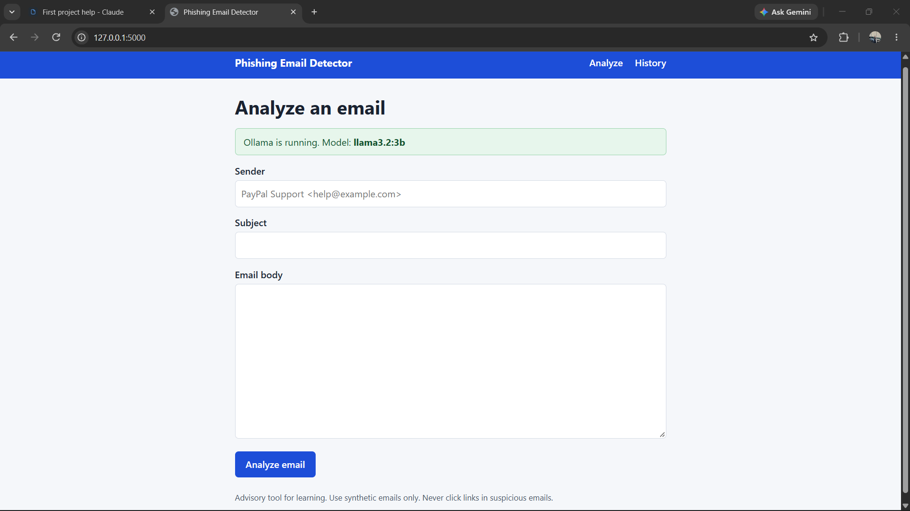
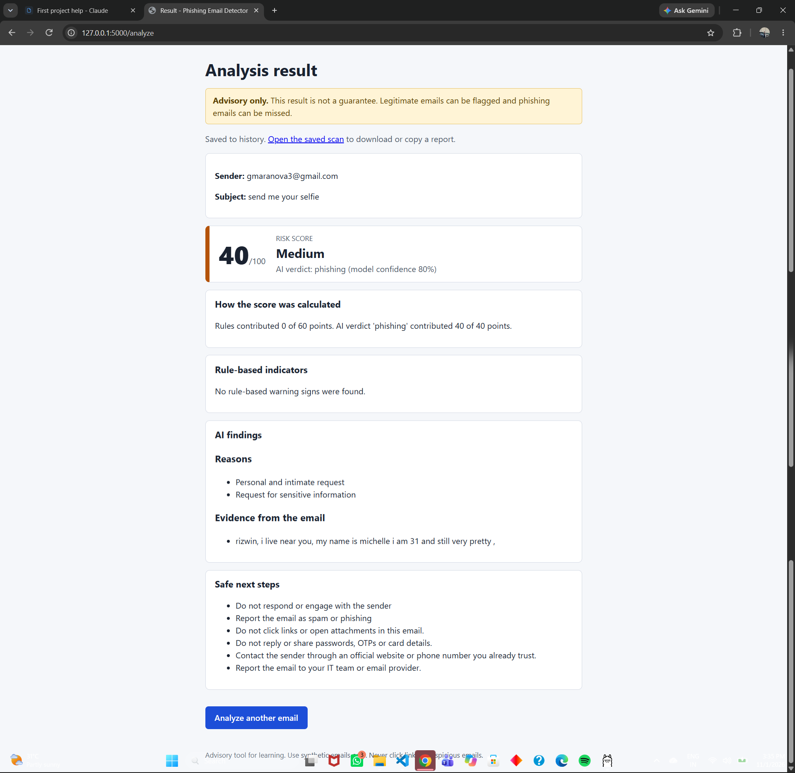
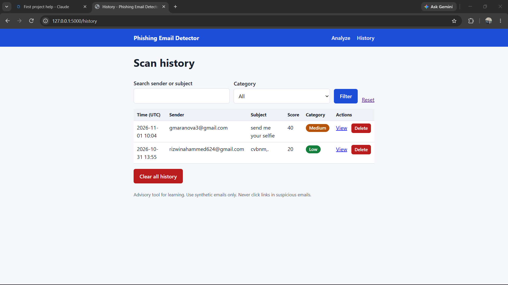
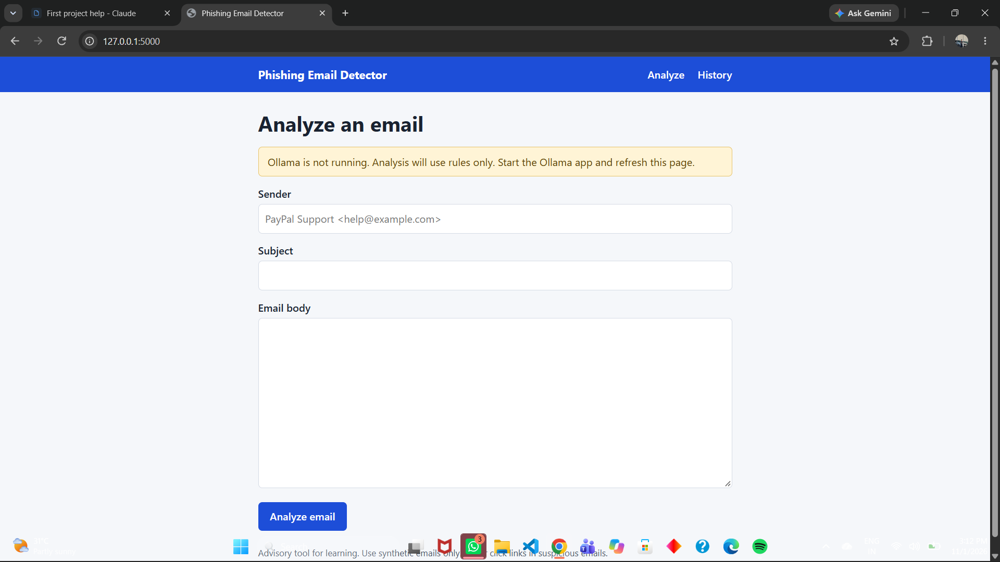

# AI-Powered Phishing Email Detector

A local web app that checks an email for phishing warning signs. It combines transparent rule-based checks with an AI model running locally in Ollama, and shows an explainable risk score from 0 to 100.

> **Advisory only.** The score is not a guarantee. Legitimate emails can be flagged and phishing emails can be missed. Use synthetic or authorized emails only.

Author: Rizwin Ahammed kp

## Features

- Form for sender, subject and email body, with input validation and size limits
- Five rule-based indicators: suspicious links, urgent language, credential requests, sender/domain mismatch, generic greeting
- AI analysis through the local Ollama API, with timeout handling and output validation
- Risk score (0-100) with Low, Medium, High and Critical categories, plus a written explanation
- Scan history in SQLite with search, category filter, detail view and safe deletion
- Report download (text and JSON) and a copy button
- The app never opens links, downloads attachments or sends emails

## Screenshots

| Home | Result |
|---|---|
|  |  |

| History | Saved scan |
|---|---|
|  |  |



## Architecture

See [docs/architecture.md](docs/architecture.md) for the diagram and request flow.

- **Flask** was chosen because it is small and easy to understand for a first project.
- **Rule engine** (`app/rules.py`): deterministic checks, each rule counted once, capped at 60 points.
- **Ollama client** (`app/ollama_client.py`): talks to the local model and validates its JSON.
- **Scoring** (`app/scoring.py`): rules (0-60) plus AI verdict (0-40), clamped to 0-100.
- **SQLite** (`app/db.py`): history, using parameterized queries.

## Scoring

| Source | Points |
|---|---|
| Rule engine | 0-60 (suspicious link 20, credential request 20, sender mismatch 20, urgent language 10, generic greeting 5, total capped at 60) |
| AI verdict | legitimate 0, suspicious 20, phishing 40 |

Categories: 0-24 Low, 25-49 Medium, 50-74 High, 75-100 Critical. These thresholds are illustrative and are not a validated security standard. Model confidence is shown separately and does not change the score.

## Prerequisites

- Python 3.11 or newer (tested with : 3.12.4)
- Git
- [Ollama](https://ollama.com)

## Ollama setup

```
ollama pull llama3.2:3b
ollama run llama3.2:3b
```

Tested model: `llama3.2:3b` (about 2 GB). Make sure the Ollama app is running before you start the web app.

## Installation

```
git clone https://github.com/r1zzwin/ai-phishing-email-detector.git
cd ai-phishing-email-detector
python -m venv .venv
.venv\Scripts\activate
pip install -r requirements.txt
```

On Mac or Linux, activate with `source .venv/bin/activate` instead.

Optional: copy `.env.example` to `.env` to change the model, URL, timeout or secret key. The defaults work without it.

## Run

```
python run.py
```

Open http://127.0.0.1:5000. The first analysis can take up to a minute while the model loads.

## Tests

```
pytest
```

Result on my machine:95 passed. Ollama is mocked in the tests, so they pass even when Ollama is off. The manual test cases and expected versus actual results are in [docs/test_report.md](docs/test_report.md).

## Security and privacy

- Input is trimmed, required and length-limited. Requests over 64 KB are refused.
- All output is escaped by the templates, and a test checks that HTML is shown as plain text.
- Database queries use parameters, and a test tries SQL injection text.
- The email body is never saved. Scan history can be deleted one by one or all at once, with confirmation.
- Logs hide email addresses and links, and the app never logs email content.
- Security headers include a Content-Security-Policy.
- The app never opens links or sends messages, because opening a suspicious link can be harmful.

## Limitations and reflection

- A small local model can be inconsistent, and a crafted email may try to steer it. That is why the AI contributes at most 40 points.
- Rules are keyword-based and English-only, so misspellings, other languages and text inside images can slip past them.
- **False positives:** a genuine bank notice that says "urgent" and "verify your account" can score high.
- **False negatives:** a well-written email with no links or trigger words can score Low.
- The delete buttons have no CSRF token and there is no login, which is acceptable for a local learning tool only.
- Local processing reduces external transmission but does not guarantee the computer, logs or database are secure.

Future improvements:

1. Read email headers (SPF, DKIM) from an uploaded `.eml` file.
2. Detect look-alike domains by comparing them with known brand names.
3. Add multi-language rules and a login with CSRF protection.

## Troubleshooting

| Problem | Fix |
|---|---|
| Yellow "Ollama is not running" box | Open the Ollama app, then refresh the page |
| "Model is not installed" | Run `ollama pull llama3.2:3b` |
| `No module named flask` | Activate the virtual environment and run `pip install -r requirements.txt` |
| `can't open file 'run.py'` | Run `cd ai-phishing-email-detector` first |
| Port 5000 already in use | Close the other program using it |
| First analysis is slow | Normal: the model is loading. Wait up to a minute |