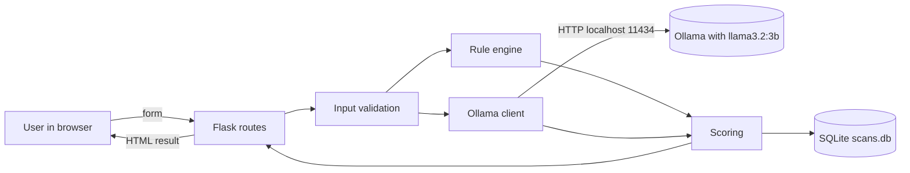
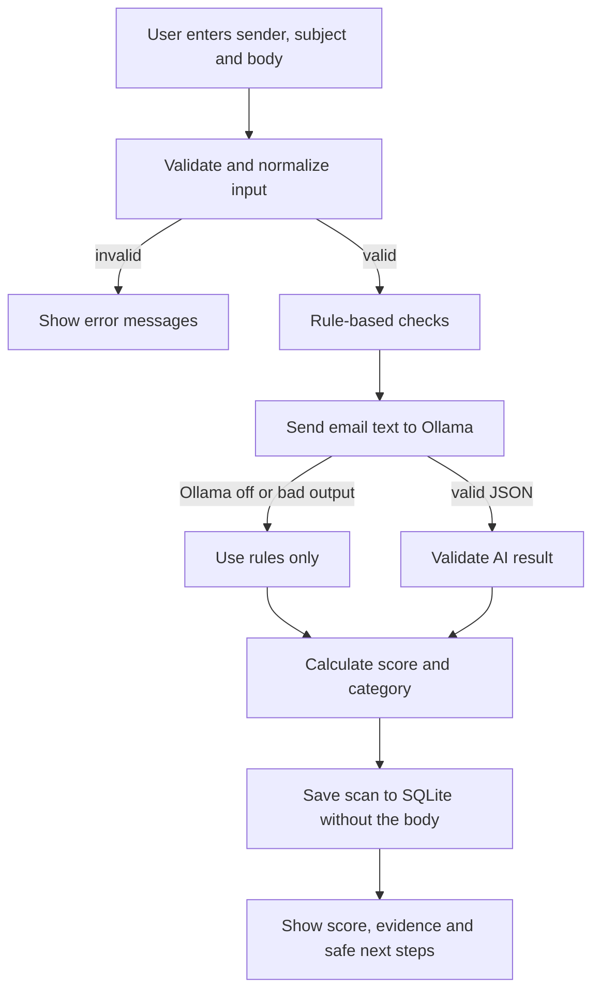

# Architecture

## System architecture

| Part | Responsibility |
|------|----------------|
| Frontend (templates, CSS, JS) | Form, result page, history page, confirmation boxes, copy button |
| Flask routes | Receive requests, call the other parts, render pages, send downloads |
| Validation | Trim input, check required fields and length limits |
| Rule engine | Five documented indicators, deterministic, capped at 60 points |
| Ollama client | Status check, prompt, timeout handling, validation of the model's JSON |
| Scoring | Rules (0-60) plus AI verdict (0-40), clamped to 0-100, mapped to a category |
| SQLite | Saves scan history. The email body is never stored |

## Request flow

